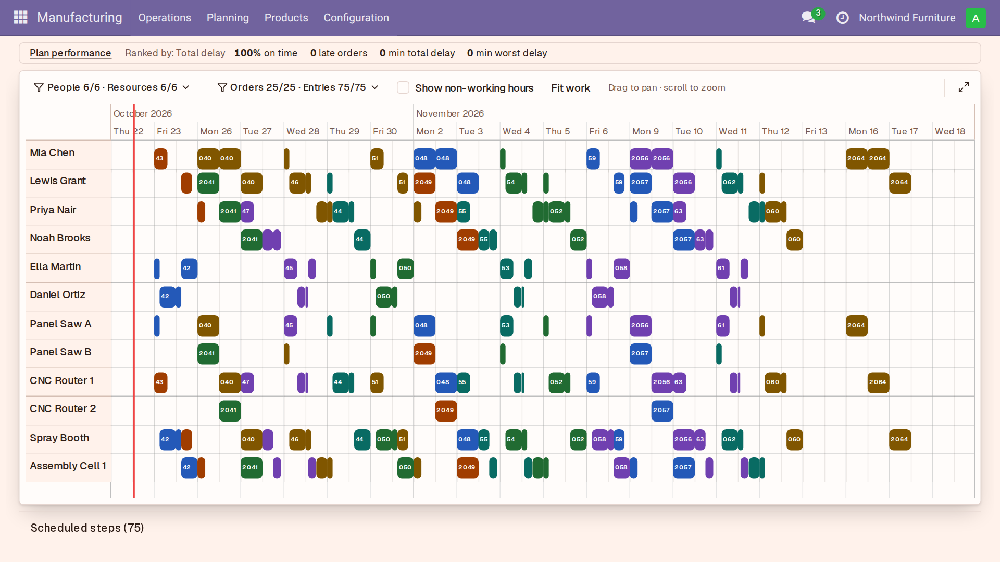
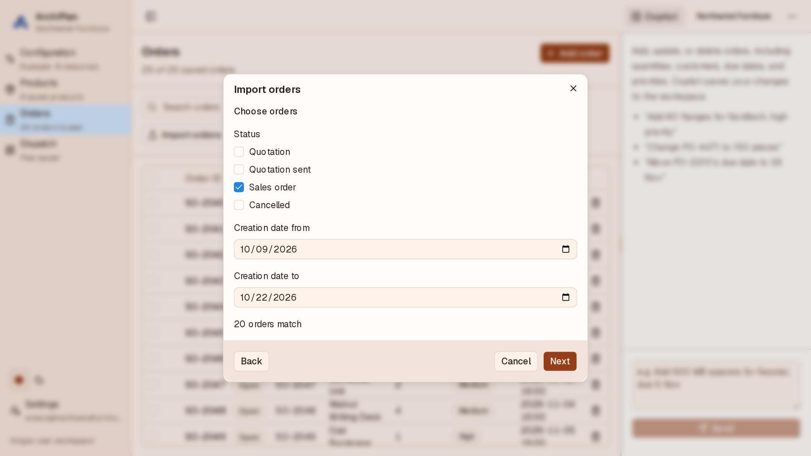

# ArchiPlan for Odoo 18.0

Turn Odoo sales orders into a production plan around your people, machines,
shifts and deadlines, and see the live schedule inside Odoo.

[ArchiPlan](https://archiplan.io) is AI production scheduling for small and
mid-sized manufacturers. Describe your shop by voice or text, build a plan,
and rebuild it when a rush job arrives or someone is off.
[Explore ArchiPlan](https://archiplan.io) to see how it fits your shop.



For Odoo 18.0. Needs an ArchiPlan account.

## What the connector adds

- **ArchiPlan Settings**: your ArchiPlan URL and view-only schedule link.
- **Create ArchiPlan access**: creates a dedicated read-only internal user and
  shows the Odoo address, database, login and API key. The key is shown only once.
- **Revoke ArchiPlan access**: removes access when you no longer need it.
- **ArchiPlan Schedule**: shows your live plan under **Manufacturing > Planning**.

The ArchiPlan user has read-only access to sales orders and products.
On Odoo Enterprise / Online, this internal user counts as one user.

## Install

Install **ArchiPlan Connector** from Odoo Apps for Odoo 18.0.

For an installation with a custom addons directory:

```bash
git clone https://github.com/ArchiPlan-io/archiplan-odoo --branch 18.0
```

Add the cloned repository to your Odoo addons path, restart your Odoo server,
update the Apps list, and install **ArchiPlan Connector**.

## Set up

1. In Odoo, open **Settings > ArchiPlan**, set your ArchiPlan URL, and click
   **Create ArchiPlan access**. Copy the Odoo address, database, login and API key.
2. In ArchiPlan, open **Orders > Import > From Odoo** and paste those details.
3. Choose sales orders by status and creation date, check the preview, and import.
4. Build the plan in ArchiPlan. Copy its view-only schedule link into
   **Settings > ArchiPlan > Schedule link** in Odoo and save.
5. Open **Manufacturing > Planning > ArchiPlan Schedule** to see the plan.



## Links and support

- [Website](https://archiplan.io)
- [Support](https://archiplan.io/#contact)
- [Privacy policy](https://archiplan.io/privacy)
- [Terms of service](https://archiplan.io/terms)

## License

MIT
